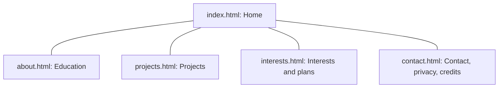

# 04. Design

## 1. Sitemap

Source: `diagrams/sitemap.mmd` (Mermaid). Image: `diagrams/sitemap.png`.

All five pages and the error page (`404.html`) carry the same header (name, menu, language and theme buttons) and footer.

## 2. Low-fidelity wireframes

`diagrams/wireframes.html` is the source; `diagrams/wireframes.png` is the rendered image (desktop home and an inner page with the card grid, mobile home and projects). Desktop header: one quiet row (name, menu with a sliding underline under the current item, language letters, theme icon), no logo and no card around it. Phone header: name with language and theme on the first row, the menu as one row that scrolls sideways. Cards sit in a grid: three columns on desktop, two on tablets, one on phones.

## 3. Diagrams

- Sequence diagram (use case "visitor changes the language"): `diagrams/sequence-language-switch.mmd`.
- Component diagram: `diagrams/components.mmd`.
- Architecture and deployment: `diagrams/architecture.mmd`.

## 4. Architecture

A static site: five HTML pages and an error page, one CSS file, three JavaScript files (`early.js`, `translations.js`, `app.js`), a favicon and the server rules file `.htaccess` (about 72 KB in total). `translations.js` defines `window.I18N` with three dictionaries of 84 keys. `early.js` runs in `<head>` before the first paint: it applies the saved theme and hides the texts that are about to be translated, so nothing flashes or jumps. Every translatable element carries `data-i18n="key"`; `app.js` replaces its text with `textContent`. The English text is also written into the HTML, so a visitor without JavaScript still reads a complete English page. `build.js` generates the five HTML files from the English dictionary so that markup stays identical across pages. The only runtime state is the chosen language and theme in `localStorage` (optional, errors are caught) and the `?lang=` parameter.

Motion (page transitions, sliding menu underline, cursor glow, hover) lives in `app.js` and `style.css`; numeric values go into a constructed style sheet, never into style attributes. Everything is switched off with the reduced-motion preference.

Hosting: the contents of `site/` (including the hidden `.htaccess`) are uploaded to the `htdocs` folder of InfinityFree free hosting (File Manager or FTP), served over HTTPS on a free `*.freedev.app` subdomain. Nothing runs on the server.

## 5. Design decisions and trade-offs

**DD-1. Client-side translation in one page set, not three page sets.**
Chosen: one HTML file per page and a JavaScript dictionary. Alternative: separate `/kk/`, `/ru/`, `/en/` pages. Pros of the choice: a single source for the text, no duplicated markup, instant switching, three times fewer files to test. Cons: one URL per page for all languages (weaker for search engines), a short moment of English text before the script runs for Kazakh/Russian visitors, and no translation without JavaScript. Mitigation: English is baked into the HTML; `?lang=` makes a language linkable; `hreflang` links can be added once the public URL exists.

**DD-2. No framework, no runtime dependencies, own CSS.**
Chosen: plain HTML/CSS/JS, with the look inspired by the Cruip "Simple Light" template but written from scratch. Alternative: use the template itself (Next.js, Tailwind) or Bootstrap. Pros: about 53 KB total, no build chain or supply-chain risk, nothing to update, works on any static host, no GPL obligations from copied code. Cons: more hand-written CSS, fewer ready components, the look only approximates the template.

**DD-3. Security by construction: strict CSP in a meta tag, no inline code.**
Chosen: `default-src 'self'`, `base-uri 'none'`, `form-action 'none'`, and no inline scripts, styles or handlers. Alternative: HTTP headers set on the server. Free hosting gives limited control of headers, so the meta tag is the portable option. Cons: a meta CSP cannot set `frame-ancestors` and similar header-only directives; this limitation is recorded in the security review.

**DD-4. GitHub as the only contact method; no form.**
Chosen: a link. Alternative: contact form or e-mail address. Pros: no personal data collected or published, no server code, no spam handling, nothing to validate. Cons: visitors need a GitHub account to write to the author. Recorded as accepted by the author.

**DD-5. Generate the HTML from a script.**
Chosen: `build.js`. Alternative: hand-written pages. Pros: header, footer and attributes cannot drift between pages. Cons: one more file to know about; the generated HTML is committed so the site can be uploaded without running anything.

**DD-6. Page transitions done by the page itself, plus the browser's cross-document transitions where available.**
Chosen: on a menu click `app.js` slides the underline to the chosen item and fades the content out (about 0.3 s), then the next page opens and its blocks rise in; in browsers that support cross-document View Transitions over HTTPS (Chrome, Edge, Safari 18+) the header is kept still during the load. Alternative A: a single-page app that swaps content with `fetch`. Alternative B: no transitions. Pros of the choice: works without a framework, every page keeps its own URL and works without JavaScript, nothing breaks in older browsers. Cons: a short extra delay before navigation; opened from a local folder the browser still blinks between pages (no View Transitions for file URLs); motion must be disabled for reduced-motion users, which is done.

**DD-7. Visual stability before the first paint.**
Chosen: a tiny `early.js` in `<head>` applies the saved theme and marks the page as pending; while pending, translated parts are invisible and transitions are off, and `app.js` settles the final look before turning transitions back on. Alternative: inline script in `<head>` (blocked by our CSP) or accepting the flash. Pros: no flash of English text, no light-to-dark flash, no header animation on load (T-21, T-23). Cons: one more request (about 0.8 KB); a 1.5 s safety timer shows the page if `app.js` fails.

## 6. Reused components and licences

| Component | Use | Licence | How it is used |
|---|---|---|---|
| Cruip "Simple Light" landing page template (github.com/cruip/tailwind-landing-page-template) | Visual inspiration only (floating header, large headings, pale gradients, dark panel) | GPL-3.0 | No code, markup, images or fonts copied; the CSS is written from scratch; credit shown on the Contact page. Copying code would have required publishing the site under GPL-3.0. |
| Inter typeface | Named first in the CSS font stack | SIL OFL 1.1 | Not shipped or downloaded; used only if already installed, otherwise system fonts. |
| Playwright 1.63 | Automated tests (development only) | Apache-2.0 | Not part of the published site. |
| Mermaid CLI (mmdc) | Rendering diagrams for the documents (development only) | MIT | Not part of the published site. |
| InfinityFree | Free hosting service | Provider terms of service | Static files only; no purchase. |
| Site code and texts | HTML/CSS/JS written for this project | MIT for code (see LICENSE); texts and project descriptions: all rights reserved by the author | |
